# remarkable-pics

**Symbol libraries for the reMarkable Paper Pro — official icons as real pen strokes you
can copy, paste and scale into any notebook. Built and extended with Claude.**

## The gap this fills

The reMarkable is a great place to think on paper: architecture sketches, presentation
storyboards, blueprints, process maps. But it has **no stencil or icon library**. If your
diagram needs an AWS Lambda icon, a database cylinder or a firewall symbol, you draw it by
hand — every time, slightly different, and never quite the official one.

The usual workarounds don't help:

- **Import a PDF or image of the icons:** it lands as a frozen background. You can look at
  it, but you can't lasso one icon and carry it into another notebook.
- **Templates:** a fixed background for the whole page, not a set of parts to pick from.
- **Draw it yourself:** slow, inconsistent, and the reason diagrams stay messy.

**This repo turns icon sets into native reMarkable notebooks.** Every icon is made of ordinary
pen strokes, exactly as if you had drawn it, so the tablet treats it like your own ink.

## How you use it on the tablet

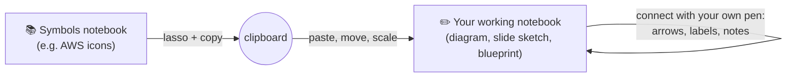

1. Keep a **symbols notebook** next to your work, e.g. the AWS icon sheet below.
2. **Lasso** the icon you need (with its title if you want it) and **copy** it.
3. Switch to the notebook you're working in and **paste**. Move and scale it to fit.
4. Draw the arrows, boundaries and notes by hand. The pasted icons stay fully editable:
   erase part of one, recolour it, resize it.

The result: diagrams with clean, official-looking symbols and your own handwriting around
them, made in minutes on the tablet.

<p align="center">
  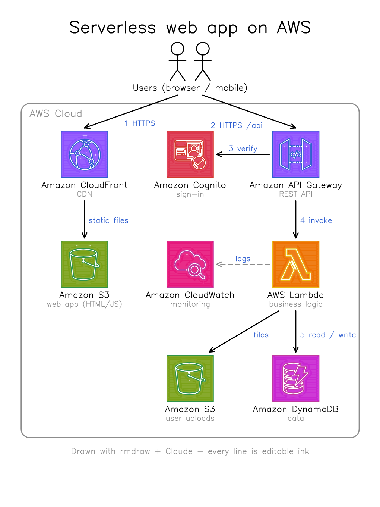
  <br><sub>A serverless web app sketched from the library: <a href="out/drawings/aws-architecture/aws-architecture.rmdoc">aws-architecture.rmdoc</a></sub>
</p>

## ⭐ Ready now: 50 AWS architecture icons

**[Download `aws-icons-top50.rmdoc`](out/aws-icons/aws-icons-top50.rmdoc)** and drag it into
the reMarkable desktop app: four pages with the 50 most-used AWS services, each a coloured,
outlined icon with its name written underneath, grouped by category.

<p align="center">
  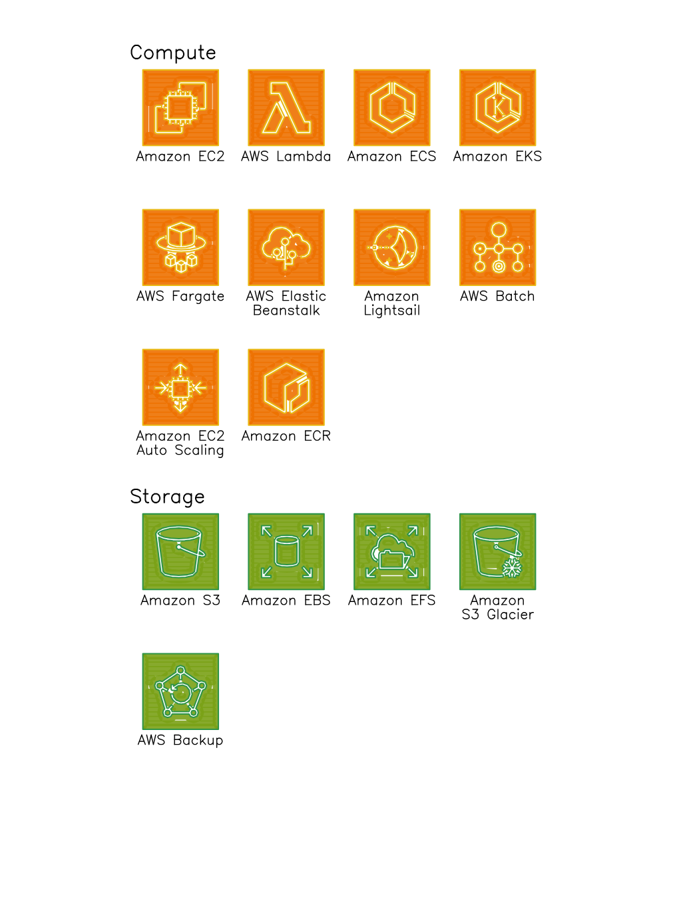
  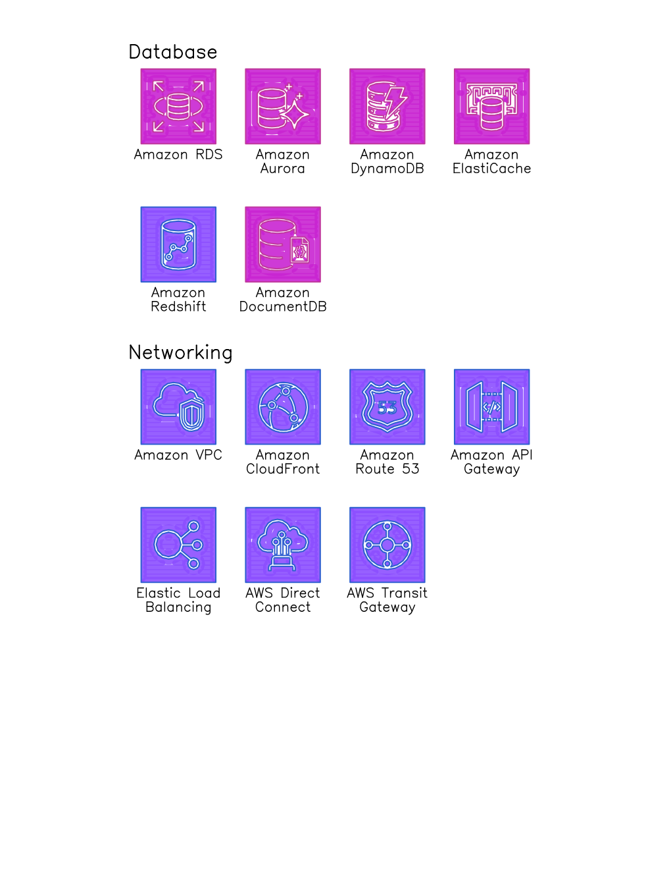
  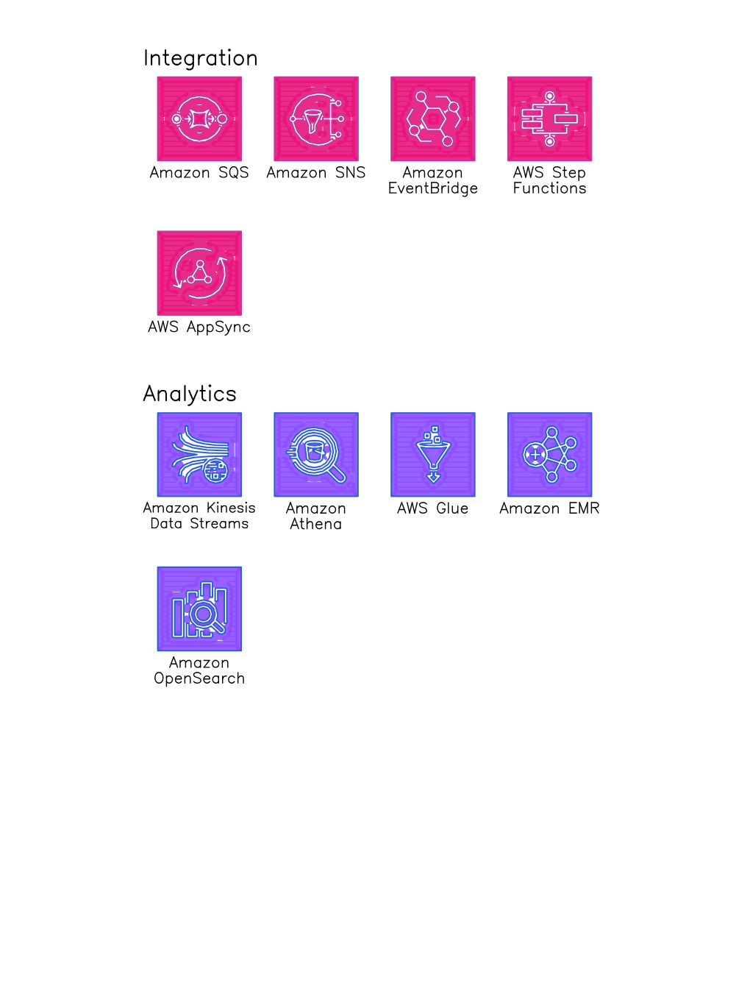
  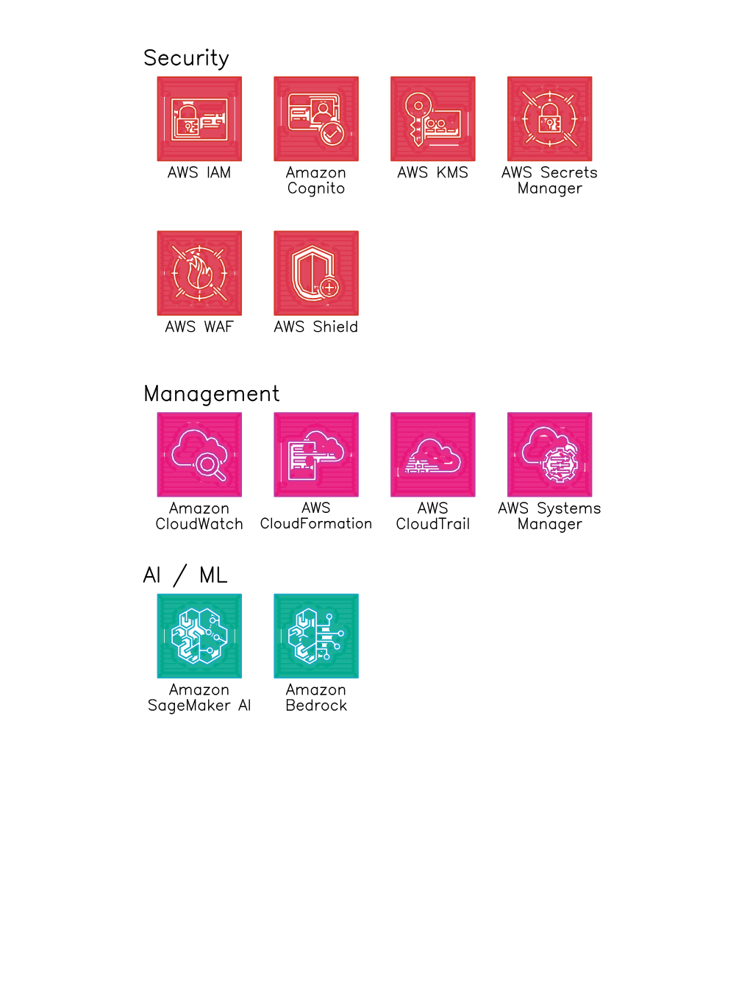
</p>

## Grow your own library with Claude

The repo includes a [Claude Code skill](.claude/skills/remarkable-native/SKILL.md) that knows
the reMarkable format. Open the project in Claude Code and ask for the symbols *you* need:

| You ask Claude… | What you get |
|---|---|
| *"Add the next 50 AWS icons: IoT, migration, containers"* | More pages for the AWS library, same style |
| *"Make me an Azure (or GCP) networking icon sheet"* | A new library from the official SVG package you download |
| *"Flowchart and BPMN symbols, with labels"* | Start/end, process, decision, gateway, event shapes |
| *"Network diagram symbols: router, switch, firewall, server, cloud"* | Generic infrastructure symbols, drawn from a description |
| *"Floor-plan symbols: doors, windows, stairs, furniture at 1:50"* | Blueprint parts that you paste and scale |
| *"Presentation doodles: people, arrows, speech bubbles, icons for ideas"* | A storyboard kit for slide sketches |

Claude converts SVGs where an official set exists, draws simple symbols from a description
where none does, previews the pages, fixes what looks off, and hands you a `.rmdoc` to drag
into the desktop app. Your library grows as your work needs it.

Icon artwork stays the property of its owners (e.g. AWS); use official sets under their terms.

## Not just icons

The same engine draws anything from a description: these were made by asking Claude for
"an owl", "a fox", "a smiley face". More ready-to-import notebooks are in the
**[gallery](out/README.md)**.

<p align="center">
  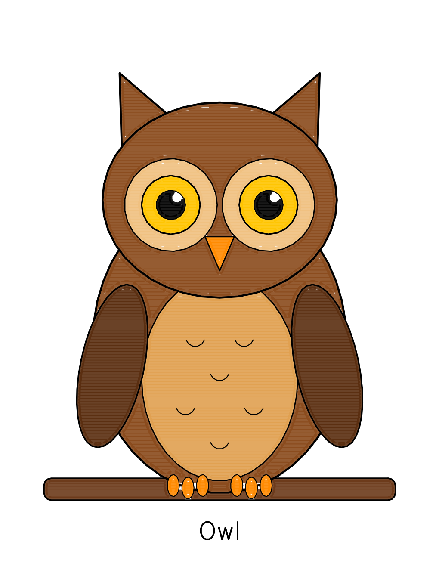
  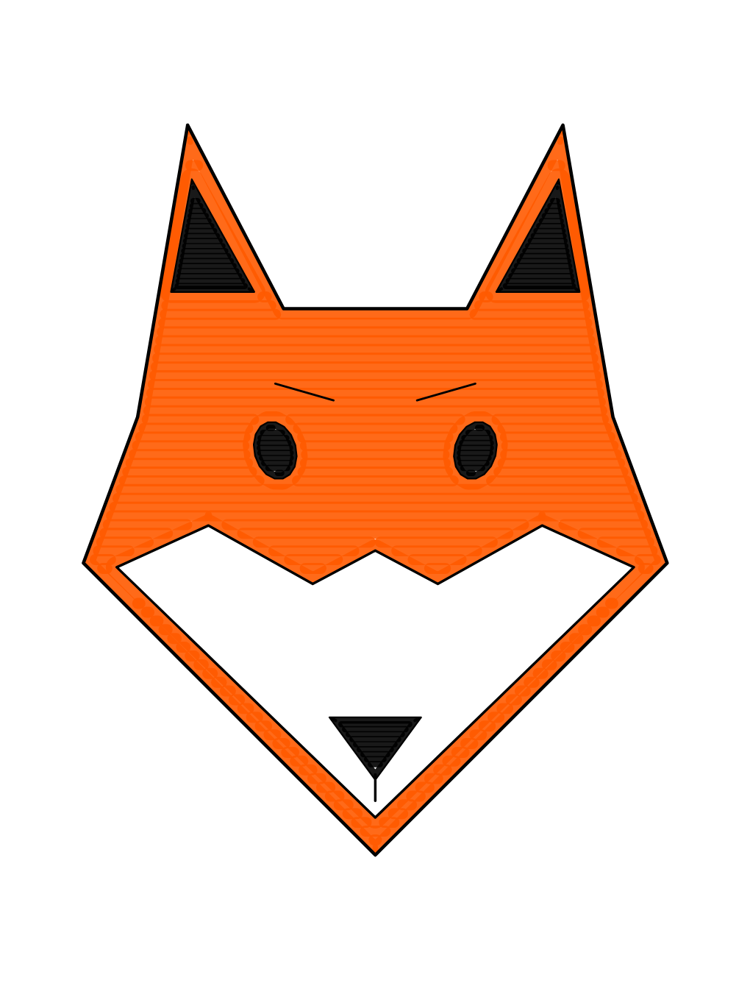
  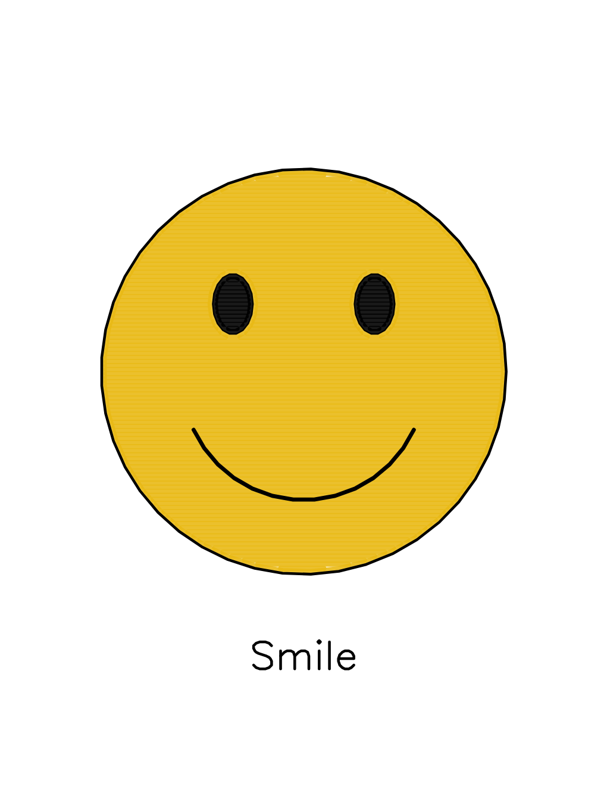
</p>

## Under the hood

`rmdraw` writes the reMarkable's own notebook format directly: v6 `.rm` scene files full of
pen strokes (fineliner outlines, shader fills, stroke-font text), packed as a `.rmdoc` that
the desktop app imports like any notebook.

- **No PDF, no embedded image, no template.** Strokes only.
- **Editable on the tablet:** lasso, copy, move, scale, erase — it all just works.
- **Colour:** fills use the shader tool, which honours any RGB colour on the Paper Pro's
  colour screen. Outlines and text use the tablet's pen palette.
- **Learned from the device:** page geometry, pen ids, colour codes and fill settings were
  measured on a real Paper Pro (see [`docs/format-notes.md`](docs/format-notes.md)).

<p align="center">
  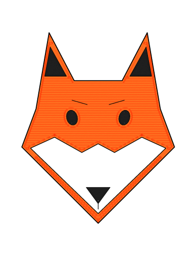
  
  <br><sub>Rendered by the tablet itself (device thumbnails): the fox and the first page of the AWS icon sheet.</sub>
</p>

### How it works

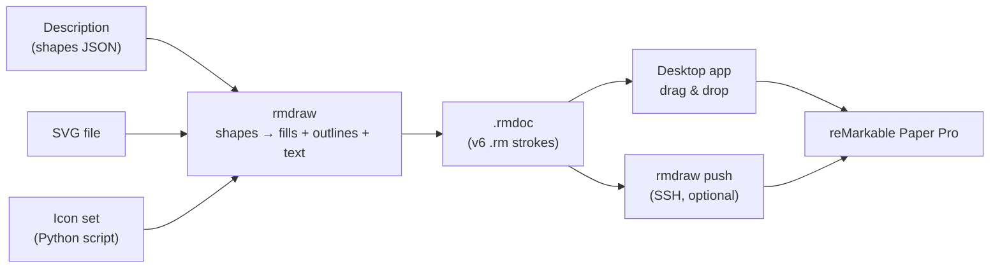

1. **Shapes** — circles, ellipses, rectangles, polylines, arcs, Bézier curves, text and
   SVGs are placed in millimetres on the page.
2. **Fills** — coloured areas become shader strokes: an edge stroke along the contour,
   parallel bands inside it and thin spurs into sharp corners, so nothing paints outside
   the shape. Items listed later hide what is underneath (painter's order).
3. **Outlines and text** — fineliner strokes on top; labels use a single-stroke Hershey font.
4. **Writing** — `rmdraw` writes the scene blocks the tablet expects (including the
   `SceneInfo` page size) via [rmscene](https://github.com/ricklupton/rmscene), and zips
   the notebook into a `.rmdoc`.

## Quick start

Requires Python 3.12+.

```bash
git clone https://github.com/vesakoo/remarkable-pics.git
cd remarkable-pics
python3 -m venv .venv
.venv/bin/pip install -e '.[dev]'
.venv/bin/pytest -q          # optional: run the test suite
```

### Draw something from a description

Write a small shapes file — this is the smiley above:

```json
{
  "name": "Smiley",
  "pages": [[
    {"type": "circle",  "cx": 90, "cy": 110, "r": 60, "width_mm": 0.8, "fill": {"color": "yellow"}},
    {"type": "ellipse", "cx": 69, "cy": 90, "rx": 6, "ry": 9, "fill": {"color": "black"}},
    {"type": "ellipse", "cx": 111, "cy": 90, "rx": 6, "ry": 9, "fill": {"color": "black"}},
    {"type": "arc", "cx": 90, "cy": 112, "r": 36, "start_deg": 25, "end_deg": 155, "width_mm": 1.2},
    {"type": "text", "text": "Smile", "x": 90, "y": 190, "height": 8}
  ]]
}
```

```bash
.venv/bin/rmdraw build examples/smiley.json -o out/smiley.rmdoc
.venv/bin/rmdraw preview out/smiley.rmdoc -o out/smiley.svg   # check it on your computer
```

Then **drag `out/smiley.rmdoc` into the reMarkable desktop app**. It syncs to the tablet
like any other notebook (if it doesn't show up right away, restart the tablet).

Coordinates are millimetres from the top-left of the 179.7 × 239.6 mm page. Fill colours
can be any `#rrggbb`; pen colours are the tablet's palette (`black gray white blue red
green yellow cyan magenta`). More examples: [`examples/owl.json`](examples/owl.json),
[`examples/fox.json`](examples/fox.json), [`examples/tree.json`](examples/tree.json).

<p align="center">
  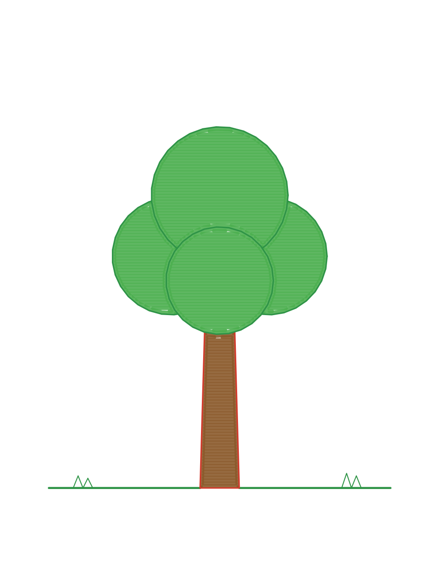
</p>

### Convert an SVG

```bash
.venv/bin/rmdraw svg logo.svg -o out/logo.rmdoc --name "Logo" [--box x,y,w,h] [--fill shader|marker|hatch|none]
```

### Build an icon sheet

[`examples/aws_icons.py`](examples/aws_icons.py) lays out the 50 most common AWS
architecture icons in a grid with a handwritten-style title under each one — four pages
of editable icons, coloured by AWS category. Download the official
[AWS Architecture Icons](https://aws.amazon.com/architecture/icons/) package and unzip it
under `vendor/aws-icons/` (git-ignored), then run `.venv/bin/python examples/aws_icons.py`.

### Install over SSH (optional)

If your tablet has developer mode and SSH enabled:

```bash
.venv/bin/rmdraw push out/owl.rmdoc --thumbs out/owl-thumbs
```

`push` only **adds** a new notebook (it refuses to overwrite) and restarts the tablet UI.
`--thumbs` fetches the tablet's own rendering so you can check the result.

> ⚠️ Turning on developer mode factory-resets a Paper Pro. You don't need it — the
> desktop app route works without it.

## Commands

| Command | What it does |
|---|---|
| `rmdraw build drawing.json -o x.rmdoc` | Shapes JSON → notebook |
| `rmdraw svg file.svg -o x.rmdoc` | SVG → notebook (outline + fill) |
| `rmdraw preview x.rmdoc -o x.svg [--page N]` | Render a page from the written strokes |
| `rmdraw dump page.rm` | One line per stroke: tool, colour, width, points, bbox |
| `rmdraw push x.rmdoc [--thumbs DIR]` | Add the notebook to the tablet over SSH |
| `rmdraw thumbs <uuid> -o DIR` | Fetch the tablet's thumbnails |

## Drawing with Claude

The repo ships a Claude Code skill, [`.claude/skills/remarkable-native`](.claude/skills/remarkable-native/SKILL.md).
Open the project in Claude Code and ask *"draw me an owl"* — it writes the shapes file,
builds the notebook, renders a preview, looks at it, fixes what's off, and hands you the
`.rmdoc`. The owl and the fox above were made this way.

## Works well with remarkable-mcp

[remarkable-mcp](https://github.com/sammorrowdrums/remarkable-mcp) is an MCP server that gives
Claude (and other assistants) access to your reMarkable library. It can read and search your
notes, recognise handwriting, render pages as images, upload PDFs and manage folders. Use it
for **reading** your tablet and this repo for **drawing** new notebooks.

What remarkable-pics adds on top of it:

| | remarkable-pics | remarkable-mcp |
|---|---|---|
| Shapes, curves and arcs from a description | ✅ | raw point lists only |
| SVG → pen strokes | ✅ | – |
| Filled areas in any colour (shader, marker, hatch) | ✅ | – |
| Solid stickers: labels, bubbles and notes that cover what's beneath | ✅ | – |
| Handwritten-style text as strokes | ✅ | typed text only |
| Ready symbol libraries (AWS icons, quantum circuits, presentation doodles) | ✅ | – |
| `.rmdoc` files for the desktop app (no developer mode) | ✅ | stroke writing over SSH only |
| New notebooks at the full Paper Pro page size | ✅ | uses the reMarkable 2 page size |

> **Note:** compared against remarkable-mcp **2.1.0** (November 2026). It is actively
> developed, so some of these features may be added there later. Check its README for
> the current state.

Tip: run it with `--read-only` if you only want Claude to read your notes.

## Tuning on the device

Fill strokes are tuned on the real screen, not just in previews. A swatch page
(`examples/fox_v2.py`) compares band spacing, overlap and colours side by side so the
smoothest option can become the default.

<p align="center">
  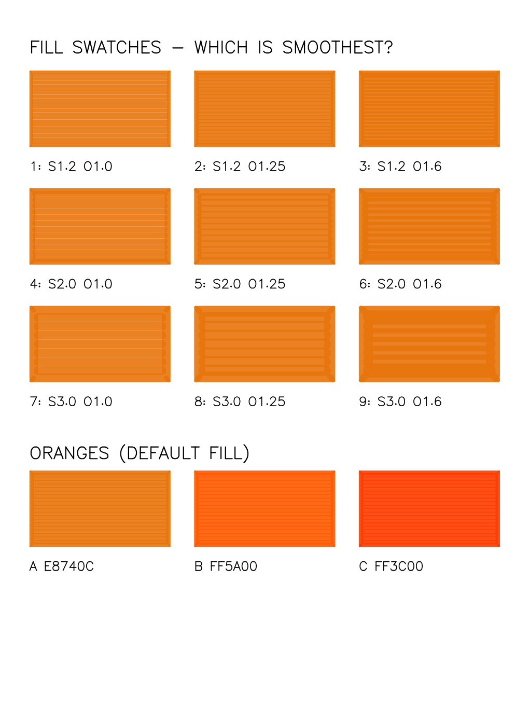
</p>

## Project layout

```
out/               the gallery: ready-to-import .rmdoc files + previews (see out/README.md)
rmdraw/            the library and CLI (fill, text, svg import, writer, device)
examples/          owl, fox, smiley, tree, AWS icon sheet, calibration pages
tools/             build_gallery.py (rebuilds out/), dump_rm.py
tests/             pytest suite, incl. reference notebooks drawn on the device
docs/format-notes.md   what we know about the Paper Pro format, tagged by evidence
.claude/skills/    the Claude Code skill
```

## Status and limits

- Target: **reMarkable Paper Pro** (software 3.29). Other models have a different page size.
- Photos and other raster images aren't converted yet (planned: vectorise first, then the SVG route).
- Text is ASCII in a single-stroke font; accents are folded (ä → a).
- Each filled object is limited to 150 strokes so the tablet stays responsive.

Built on [rmscene](https://github.com/ricklupton/rmscene), [shapely](https://shapely.readthedocs.io),
[svgelements](https://github.com/meerk40t/svgelements) and the Hershey fonts. Not affiliated with reMarkable AS.
