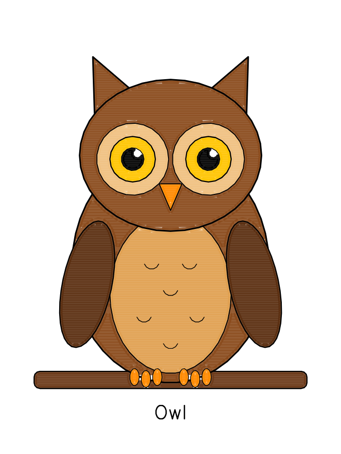
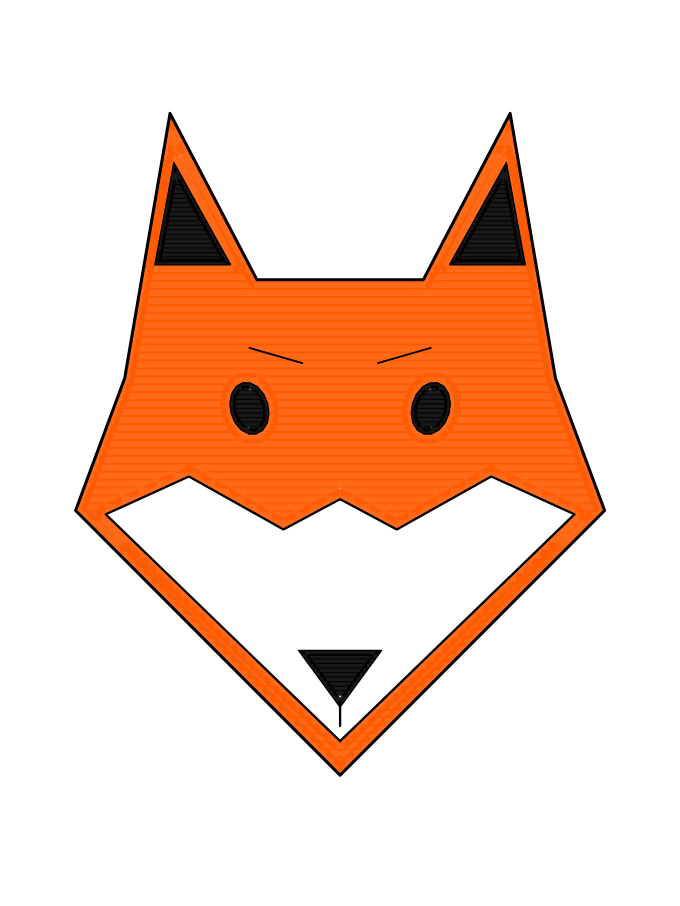
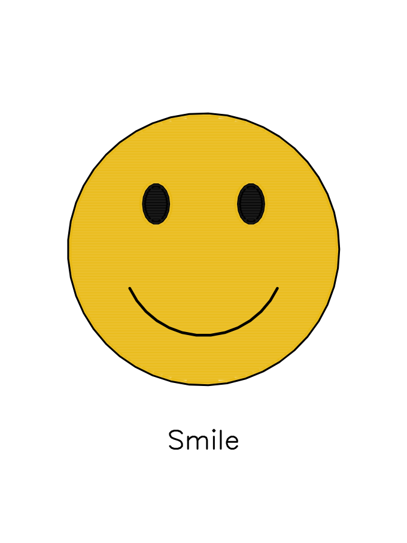
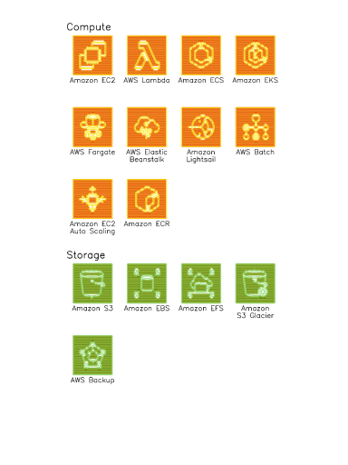
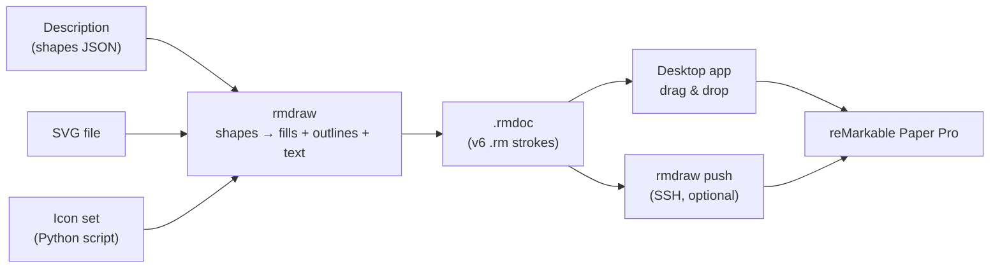
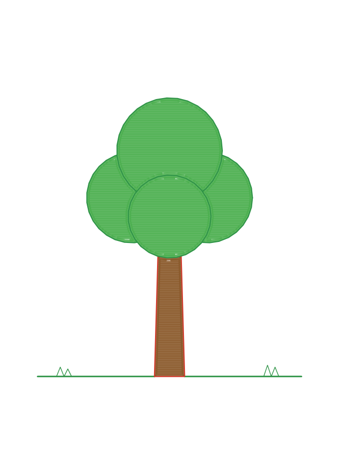
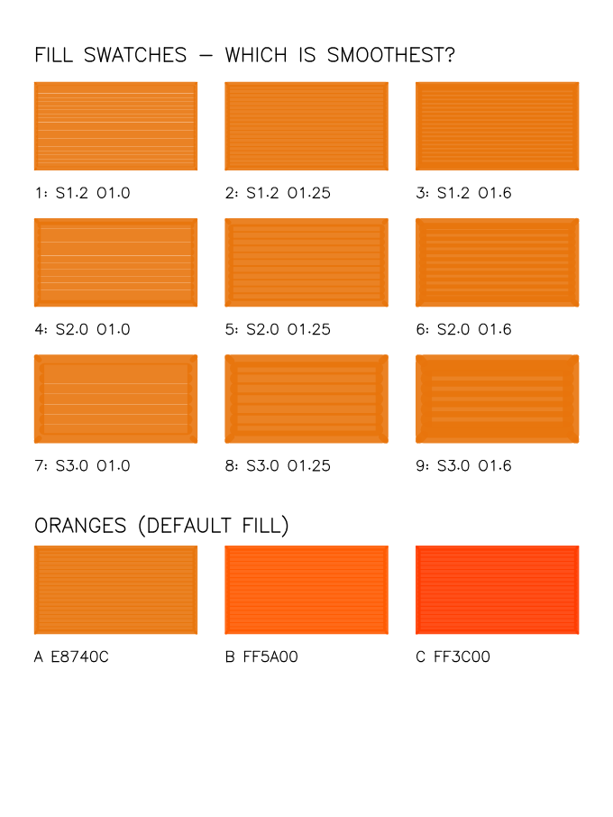

# remarkable-pics

**Draw on a reMarkable Paper Pro with code — as real, editable pen strokes.**

`rmdraw` turns a short description, an SVG file or an icon set into a native reMarkable
notebook (`.rmdoc`). Every line in it is an ordinary pen stroke, exactly as if you had
drawn it with the Marker yourself: you can erase it, lasso it, move it, copy it and scale
it on the tablet.

<p align="center">
  
  
  
</p>

## The problem

Getting a picture onto a reMarkable usually means importing a **PDF or an image**. That
works for reading, but the result is a frozen background layer: you can write on top of
it, but you can't pick up a single icon, recolour a shape, erase half a line or scale one
part of the drawing. Diagrams, icon sheets and sketches you want to *work with* end up
dead on the page.

## The solution

This project writes the reMarkable's own notebook format directly: v6 `.rm` scene files
full of pen strokes (fineliner outlines, shader fills, stroke-font text), packed as a
`.rmdoc` that the desktop app imports like any notebook.

- **No PDF, no embedded image, no template.** Strokes only.
- **Editable on the tablet:** lasso, copy, move, scale, erase — it all just works.
- **Colour:** fills use the shader tool, which honours any RGB colour on the Paper Pro's
  colour screen. Outlines and text use the tablet's pen palette.
- **Learned from the device:** page geometry, pen ids, colour codes and fill settings were
  measured on a real Paper Pro (see [`docs/format-notes.md`](docs/format-notes.md)).

<p align="center">
  
  
  <br><sub>Rendered by the tablet itself (device thumbnails): the fox and the first page of the AWS icon sheet.</sub>
</p>

## How it works



1. **Shapes** — circles, ellipses, rectangles, polylines, arcs, Bézier curves, text and
   SVGs are placed in millimetres on the page.
2. **Fills** — coloured areas become shader strokes: an edge stroke along the contour,
   parallel bands inside it and thin spurs into sharp corners, so nothing paints outside
   the shape. Items listed later hide what is underneath (painter's order).
3. **Outlines and text** — fineliner strokes on top; labels use a single-stroke Hershey font.
4. **Writing** — `rmdraw` writes the scene blocks the tablet expects (including the
   `SceneInfo` page size) via [rmscene](https://github.com/ricklupton/rmscene), and zips
   the notebook into a `.rmdoc`.

## Quick start

Requires Python 3.12+.

```bash
git clone https://github.com/vesakoo/remarkable-pics.git
cd remarkable-pics
python3 -m venv .venv
.venv/bin/pip install -e '.[dev]'
.venv/bin/pytest -q          # optional: run the test suite
```

### Draw something from a description

Write a small shapes file — this is the smiley above:

```json
{
  "name": "Smiley",
  "pages": [[
    {"type": "circle",  "cx": 90, "cy": 110, "r": 60, "width_mm": 0.8, "fill": {"color": "yellow"}},
    {"type": "ellipse", "cx": 69, "cy": 90, "rx": 6, "ry": 9, "fill": {"color": "black"}},
    {"type": "ellipse", "cx": 111, "cy": 90, "rx": 6, "ry": 9, "fill": {"color": "black"}},
    {"type": "arc", "cx": 90, "cy": 112, "r": 36, "start_deg": 25, "end_deg": 155, "width_mm": 1.2},
    {"type": "text", "text": "Smile", "x": 90, "y": 190, "height": 8}
  ]]
}
```

```bash
.venv/bin/rmdraw build examples/smiley.json -o out/smiley.rmdoc
.venv/bin/rmdraw preview out/smiley.rmdoc -o out/smiley.svg   # check it on your computer
```

Then **drag `out/smiley.rmdoc` into the reMarkable desktop app**. It syncs to the tablet
like any other notebook (if it doesn't show up right away, restart the tablet).

Coordinates are millimetres from the top-left of the 179.7 × 239.6 mm page. Fill colours
can be any `#rrggbb`; pen colours are the tablet's palette (`black gray white blue red
green yellow cyan magenta`). More examples: [`examples/owl.json`](examples/owl.json),
[`examples/fox.json`](examples/fox.json), [`examples/tree.json`](examples/tree.json).

<p align="center">
  
</p>

### Convert an SVG

```bash
.venv/bin/rmdraw svg logo.svg -o out/logo.rmdoc --name "Logo" [--box x,y,w,h] [--fill shader|marker|hatch|none]
```

### Build an icon sheet

[`examples/aws_icons.py`](examples/aws_icons.py) lays out the 50 most common AWS
architecture icons in a grid with a handwritten-style title under each one — four pages
of editable icons, coloured by AWS category. Download the official
[AWS Architecture Icons](https://aws.amazon.com/architecture/icons/) package and unzip it
under `vendor/aws-icons/` (git-ignored), then run `.venv/bin/python examples/aws_icons.py`.

### Install over SSH (optional)

If your tablet has developer mode and SSH enabled:

```bash
.venv/bin/rmdraw push out/owl.rmdoc --thumbs out/owl-thumbs
```

`push` only **adds** a new notebook (it refuses to overwrite) and restarts the tablet UI.
`--thumbs` fetches the tablet's own rendering so you can check the result.

> ⚠️ Turning on developer mode factory-resets a Paper Pro. You don't need it — the
> desktop app route works without it.

## Commands

| Command | What it does |
|---|---|
| `rmdraw build drawing.json -o x.rmdoc` | Shapes JSON → notebook |
| `rmdraw svg file.svg -o x.rmdoc` | SVG → notebook (outline + fill) |
| `rmdraw preview x.rmdoc -o x.svg [--page N]` | Render a page from the written strokes |
| `rmdraw dump page.rm` | One line per stroke: tool, colour, width, points, bbox |
| `rmdraw push x.rmdoc [--thumbs DIR]` | Add the notebook to the tablet over SSH |
| `rmdraw thumbs <uuid> -o DIR` | Fetch the tablet's thumbnails |

## Drawing with Claude

The repo ships a Claude Code skill, [`.claude/skills/remarkable-native`](.claude/skills/remarkable-native/SKILL.md).
Open the project in Claude Code and ask *"draw me an owl"* — it writes the shapes file,
builds the notebook, renders a preview, looks at it, fixes what's off, and hands you the
`.rmdoc`. The owl and the fox above were made this way.

## Tuning on the device

Fill strokes are tuned on the real screen, not just in previews. A swatch page
(`examples/fox_v2.py`) compares band spacing, overlap and colours side by side so the
smoothest option can become the default.

<p align="center">
  
</p>

## Project layout

```
rmdraw/            the library and CLI (fill, text, svg import, writer, device)
examples/          owl, fox, smiley, tree, AWS icon sheet, calibration pages
tests/             pytest suite, incl. reference notebooks drawn on the device
docs/format-notes.md   what we know about the Paper Pro format, tagged by evidence
.claude/skills/    the Claude Code skill
```

## Status and limits

- Target: **reMarkable Paper Pro** (software 3.29). Other models have a different page size.
- Photos and other raster images aren't converted yet (planned: vectorise first, then the SVG route).
- Text is ASCII in a single-stroke font; accents are folded (ä → a).
- Each filled object is limited to 150 strokes so the tablet stays responsive.

Built on [rmscene](https://github.com/ricklupton/rmscene), [shapely](https://shapely.readthedocs.io),
[svgelements](https://github.com/meerk40t/svgelements) and the Hershey fonts. Not affiliated with reMarkable AS.
