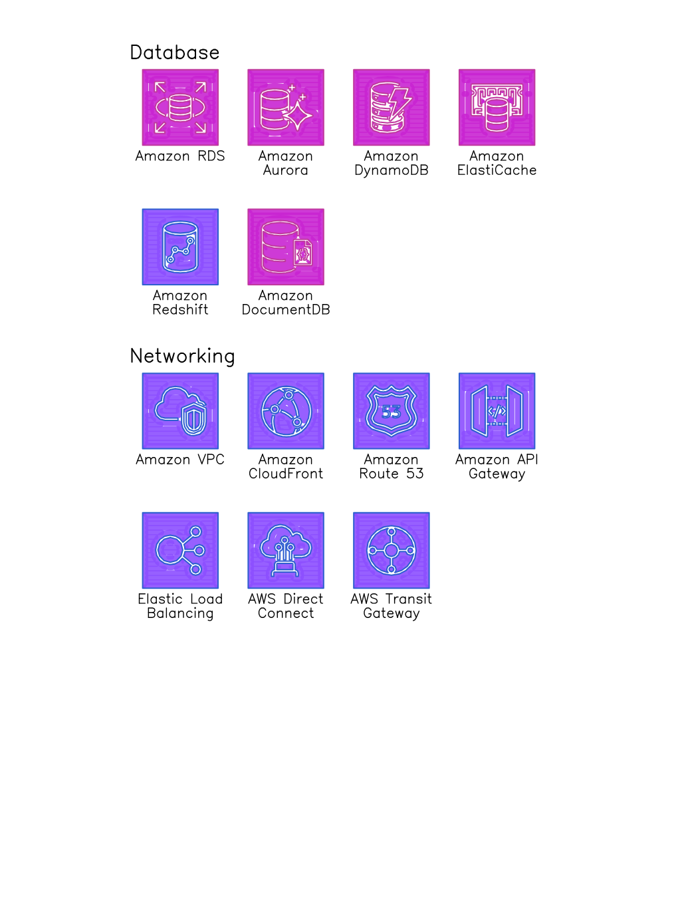
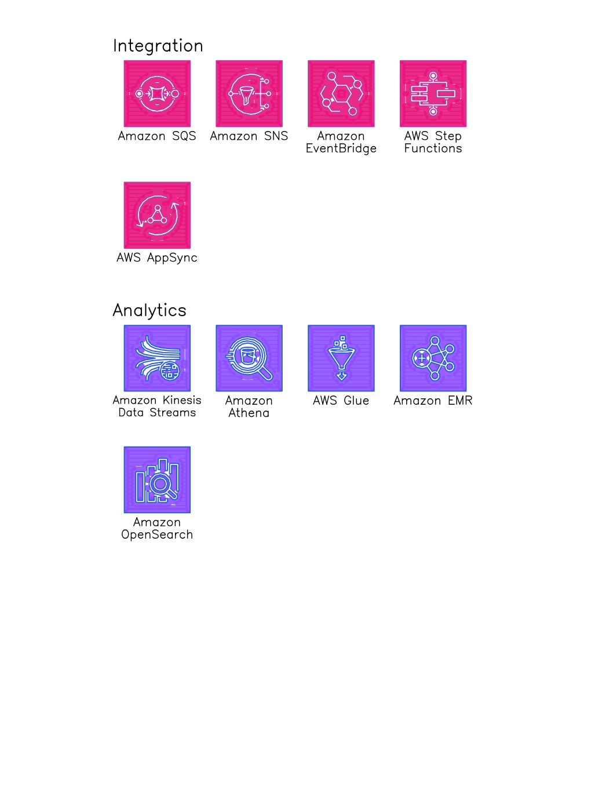
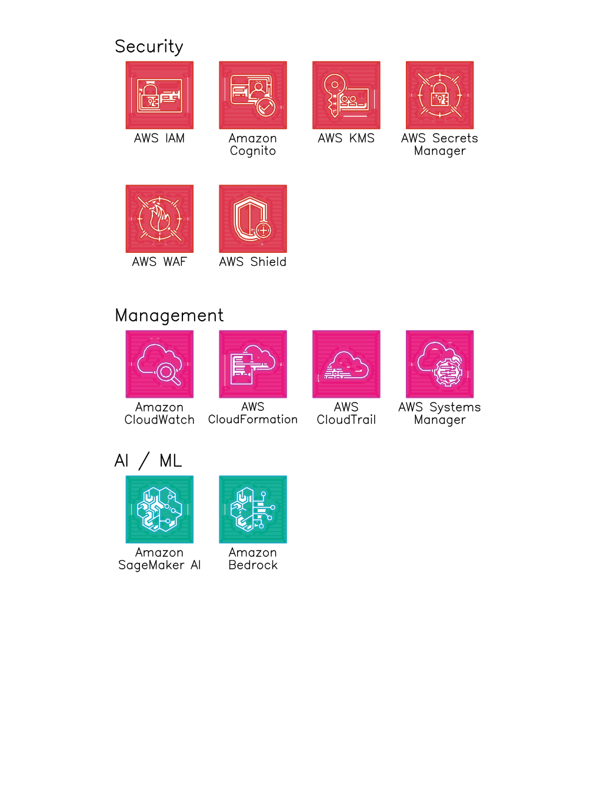
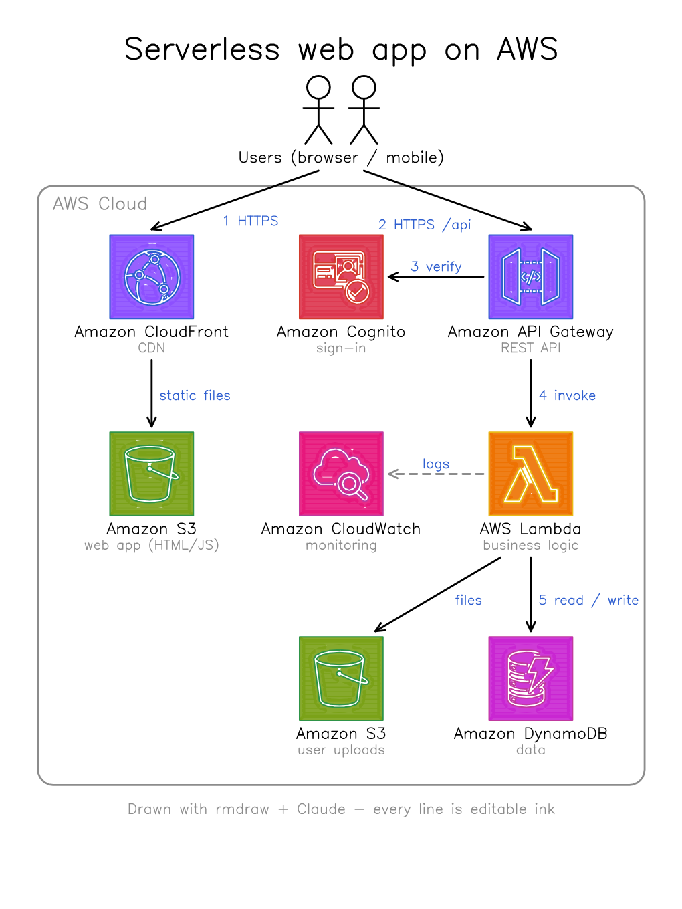
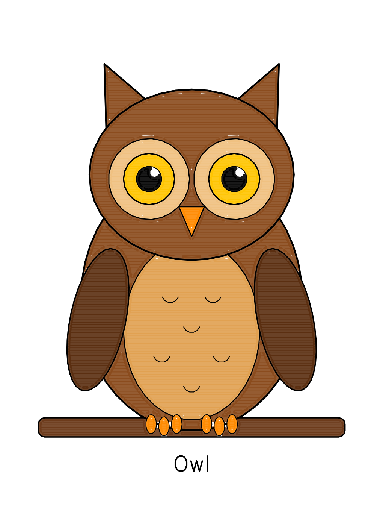

# Gallery — ready-to-import reMarkable notebooks

Every `.rmdoc` here is a native notebook for the **reMarkable Paper Pro**: real pen
strokes you can erase, lasso, move, copy and scale. Download one and **drag it into the
reMarkable desktop app**; it syncs to the tablet (restart the tablet if it doesn't show up).

Rebuild everything with `.venv/bin/python tools/build_gallery.py` (the AWS sheet needs the
icon package, see below). PNGs are previews rendered from the written strokes; files in
`tablet/` are the tablet's own renderings.

## ⭐ AWS architecture icons — top 50

[`aws-icons/aws-icons-top50.rmdoc`](aws-icons/aws-icons-top50.rmdoc) · 4 pages · 50 icons ·
~5 000 strokes. Each icon is a coloured, outlined shape with its name handwritten underneath,
grouped by category. Lasso an icon and its title, copy it into your own notes and scale it
— instant hand-drawn architecture diagrams.

| Compute & Storage | Database & Networking |
|---|---|
|  |  |
| **Integration & Analytics** | **Security, Management & ML** |
|  |  |

On the tablet (page 1, an earlier build): [`aws-icons/tablet/aws-icons-p1-tablet.png`](aws-icons/tablet/aws-icons-p1-tablet.png)

Source: [`examples/aws_icons.py`](../examples/aws_icons.py) with
[`data/aws_top50.json`](../data/aws_top50.json). It needs the official
[AWS Architecture Icons](https://aws.amazon.com/architecture/icons/) package unzipped under
`vendor/aws-icons/`. The icons are © Amazon Web Services and are used under AWS's terms for
architecture diagrams.

## Drawings

| | Notebook | Made from | Strokes |
|---|---|---|---|
|  | [aws-architecture.rmdoc](drawings/aws-architecture/aws-architecture.rmdoc) | [examples/aws_architecture.py](../examples/aws_architecture.py) | 1259 |
|  | [owl.rmdoc](drawings/owl/owl.rmdoc) | [examples/owl.json](../examples/owl.json) | 799 |
|  | [fox.rmdoc](drawings/fox/fox.rmdoc) · [on tablet](drawings/fox/tablet/fox-tablet.png) | [examples/fox.json](../examples/fox.json) | 235 |
|  | [smiley.rmdoc](drawings/smiley/smiley.rmdoc) | [examples/smiley.json](../examples/smiley.json) | 175 |
|  | [tree.rmdoc](drawings/tree/tree.rmdoc) | [examples/tree.json](../examples/tree.json) | 246 |

## Calibration

Test pages used to learn how the tablet renders pens and fills.

| | Notebook | What it tests |
|---|---|---|
|  | [pens-and-fills.rmdoc](calibration/pens-and-fills.rmdoc) | page corners and a 10 mm grid, every pen, shader colours and alpha, icon fill variants ([on tablet](calibration/tablet/pens-and-fills-p1-tablet.png)) |
|  | [fill-swatches.rmdoc](calibration/fill-swatches.rmdoc) | fill band spacing × overlap, and three oranges |

## Layout

```
out/
├── aws-icons/      aws-icons-top50.rmdoc, page previews, tablet/
├── drawings/<name>/<name>.rmdoc + <name>.png (+ tablet/)
├── calibration/    test notebooks
└── *.*             anything loose here is scratch (git-ignored)
```
